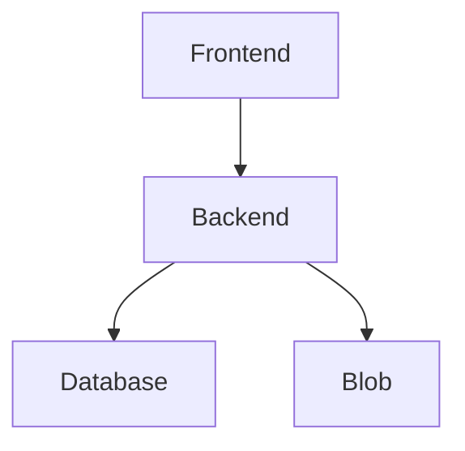

- Frontend: TypeScript - React -  Vite?, Expo (App?), Flutter?? - Static Web App?
	- Web app first
	- Then pivot towards native app?
- Backend: Python - FastAPI - Function App (Flex Consumption Plan)
	- SQLModel + Alembic
- Database: PostgreSQL - Supabase
- Files: Blobs - CDN? 

Mockup (PR preview sites): the app can run without a backend, with everything in memory. The other players are sample data on canned demo days, not a simulation, so the game rules live only in the backend and the shared rules. A "Start on day 8" option on the sign-up screen jumps straight to the Monday after a first week, with its ranking, weekly hero and win rates. In the shipped app, players with the `manage:servers` permission can try the mockup too: a "Try the mockup" button in the app bar opens a fresh demo game over the real one, under a bar to exit it; nothing of it is kept.

Development directories:
- docs
- frontend
- backend
- database?

Architecture

Terraform infrastructure:
- Static Web App (Frontend, Static Flutter Deployment)
- Function App (Consumption Flex, Python, ASGI, Authentication)
- 2x Storage Accounts (One for Function App, one for blob storage)
- Supabase Account