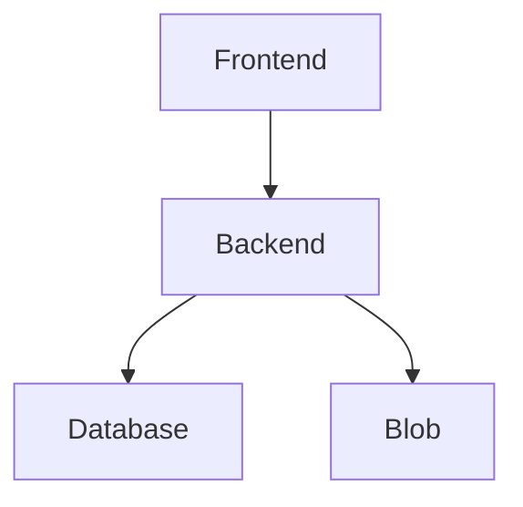

- Frontend: TypeScript - React -  Vite?, Expo (App?), Flutter?? - Static Web App?
	- Web app first
	- Then pivot towards native app?
- Backend: Python - FastAPI - Function App (Flex Consumption Plan)
	- SQLModel + Alembic
- Database: PostgreSQL - Supabase
- Files: Blobs - CDN? 

Development directories:
- docs
- frontend
- backend
- database?

Architecture

Terraform infrastructure:
- Static Web App (Frontend, Static Flutter Deployment)
- Function App (Consumption Flex, Python, ASGI, Authentication)
- 2x Storage Accounts (One for Function App, one for blob storage)
- Supabase Account